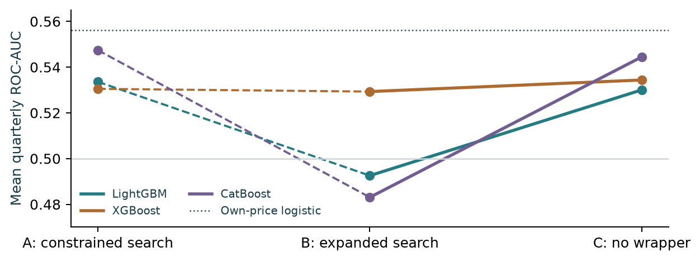

# Economic features and selection risk in daily USD/JPY forecasting

**Author: Sai Reddivari**

Can economic information improve prediction of a meaningful positive USD/JPY move beyond the currency’s own recent history?

The study turns hypotheses about relative rates, yen carry, Japanese sectors and global risk into 39 availability-aware features. It compares three selection designs over eight chronological development quarters, then evaluates frozen classifiers against logistic and own-price baselines.

**The useful finding was as much about selection as prediction.** Expanding a backward search raised inner-validation scores without improving later quarters. A controlled no-wrapper replay improved LightGBM and CatBoost; XGBoost changed little. On the original 229 reserved decisions, expanded-input XGBoost achieved mean quarterly AUC **0.617**, versus **0.553** for its own-price twin and **0.549** for logistic. CatBoost reached **0.597**; LightGBM did not improve on its own-price twin.

Dashed segments change multiple settings; solid segments remove only the wrapper while keeping the other selection and tuning rules matched. These are **development**, not reserved-year results.

Read the [main research report](reports/usdjpy_research.pdf) or the optional [technical appendix](reports/usdjpy_technical_appendix.pdf). The [editorial note](EDITORIAL_NOTE.md) explains what was condensed or omitted. Editable sources are in [latex/](latex/).

## Interpretation

CatBoost was nominated before reserved scoring; XGBoost subsequently led the ranking. Neither is presented as a proven trading strategy. Timing and data-vintage assumptions remain, the historical period informed some feature hypotheses, and precision/calibration are weak. CatBoost’s twin comparison also differs in an untuned effective default.

The original common sample excludes 29 days under a positioning-age policy, despite complete FX prices. A **post-hoc** 258-day frozen-model sensitivity retains mean AUC of 0.612 for XGBoost and 0.593 for CatBoost. It is reported separately, not as a replacement or independent confirmation.

## Reproduce the public exhibits

From this directory:

~~~bash
python scripts/check_public_artifacts.py
python -m pip install matplotlib
python scripts/build_exhibits.py
# Optional: install Tectonic, then:
python scripts/build_reports.py
~~~

The first command uses only Python’s standard library. The exhibit builder reads **saved aggregate CSV/JSON** and does not load models, score predictions or fetch data. PDF compilation may download TeX support files on its first use. Included PDFs need no compiler.

**This is not a standalone end-to-end reproduction archive.** Raw FMP FX/ETF prices, licensed J-Quants sectors, public-source caches, private derived tables, frozen models, per-row predictions and historical execution drivers are excluded. [Data sources](data_sources.md) lists providers, routes and snapshot hashes; later downloads may differ.

Research reproduction requires the recorded dependencies and restored artifacts, configured as described in the [reproduction guide](REPRODUCTION.md). Missing private inputs fail explicitly; public-only features do not reproduce the locked procedure. The historical 63-check result applies to the complete local environment, not this public snapshot.

## Implementation and contribution

[usdjpy/](usdjpy/) separates sources, timing, labels, features, splits, selection, fitting and evaluation. Computational modules are unchanged from the verified refactor; [provenance](provenance/) records hashes and evidence inputs. No new experiment was run for this publication.

Sai Reddivari led the question, hypotheses, research decisions and review. Python implementation and execution used substantial Codex/Claude assistance, including bounded source research, collection, tests, refactoring, derivation review and drafting. This is a directed, inspected AI-assisted workflow, not a claim of wholly unaided authorship.

Questions or reproduction guidance: Sai Reddivari — reddivari.sai95@gmail.com.
